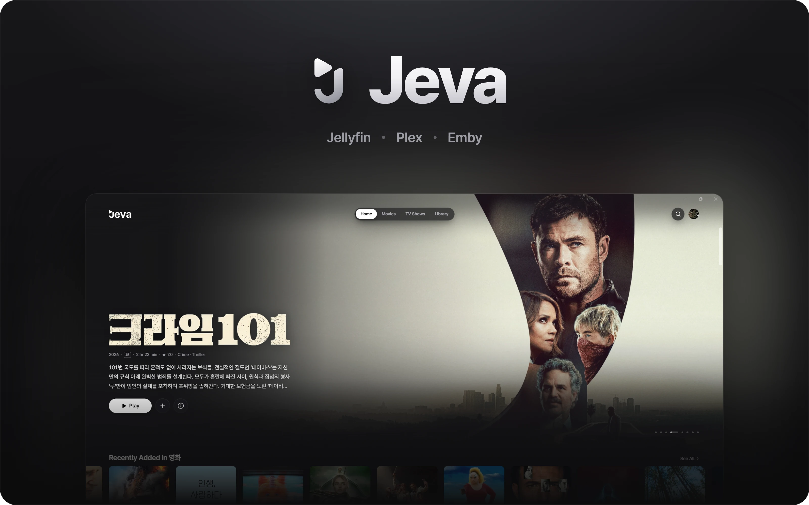
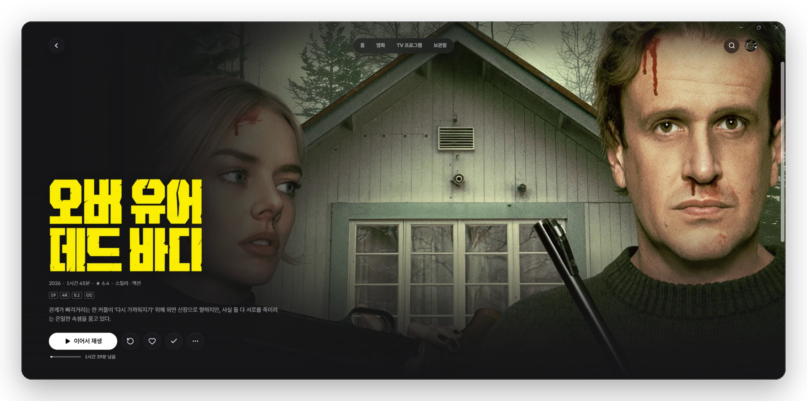
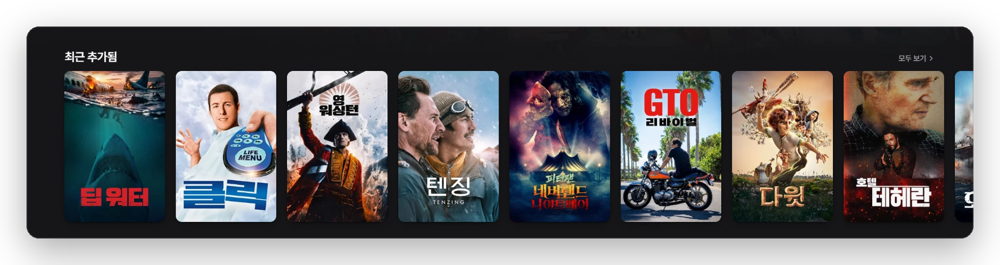
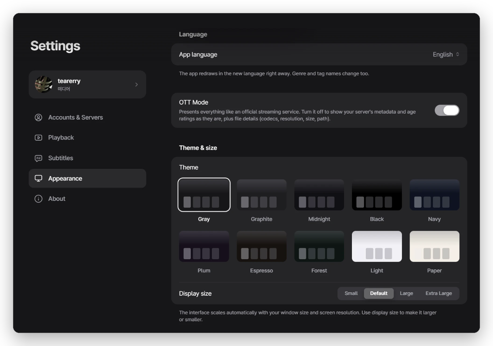

  

<h3 align="center">メディアサーバーの映画や番組を、もっと美しく。</h3>

Jevaは、Jellyfin・Plex・Embyのための洗練されたWindowsアプリです。軽快で映画館のような画面で、自分だけのストリーミングサービスのように楽しめます。

  <a href="https://github.com/tearerry/Jeva/releases/latest"><picture><source media="(prefers-color-scheme: dark)" srcset="../../assets/buttons/download-ja-dark.90a709523500.png"></picture></a>&nbsp;&nbsp;
  <a href="https://github.com/tearerry/Jeva/releases"><picture><source media="(prefers-color-scheme: dark)" srcset="../../assets/buttons/notes-ja-dark.cfae22be5289.png"></picture></a>

Windows 10 / 11 · x64 · インストーラーまたはポータブルZIP

<a href="../../README.md">English</a> · <a href="README.ko.md">한국어</a> · <b>日本語</b> · <a href="README.zh-CN.md">简体中文</a> · <a href="README.zh-TW.md">繁體中文</a> · <a href="README.es.md">Español</a> · <a href="README.fr.md">Français</a> · <a href="README.de.md">Deutsch</a> · <a href="README.pt-BR.md">Português (BR)</a> · <a href="README.it.md">Italiano</a> · <a href="README.nl.md">Nederlands</a> · <a href="README.ru.md">Русский</a> · <a href="README.tr.md">Türkçe</a> · <a href="README.id.md">Bahasa Indonesia</a> · <a href="README.ar.md">العربية</a>

 

<h3 align="center">どの作品も、いちばん美しく</h3>

タイトルロゴやアートワーク、キャスト、知りたい情報をひとつの画面に。再生すれば、止めたところから続きが始まります。

 

<h3 align="center">眺めるだけで楽しい</h3>

新着作品、今週のTOP 10、テーマ別のおすすめ。すべてあなたのライブラリから作られます。

 

<h3 align="center">あなた好みに</h3>

10種類のテーマ、4段階の表示サイズ、自由なホームのレイアウト、タブごとのスタイルまで。

 

## 細部まで

- **最初のシーンから字幕** ファイルから直接読み込むので、どこへスキップしてもすぐに表示されます。
- **あなたの言語と地域** 15言語に対応し、年齢レーティングはお住まいの国の方式で表示します。
- **ホームを自由に** ホームに表示するライブラリを選び、ライブラリごとにタブを分けられます。
- **ネタバレ防止** まだ観ていないエピソードのあらすじを、ライブラリごとにぼかして隠します。
- **特典映像と写真** 作品ページで予告編やメイキングを。写真アルバムはフルスクリーンで。
- **続きからそのまま** 視聴中の作品と次のエピソードは、いつもサーバーと同期しています。

## はじめかた

Windows 10または11（x64）と、Jellyfin・Plex・Embyのいずれかのサーバーが必要です。

1. <a href="https://github.com/tearerry/Jeva/releases/latest">最新リリース</a>からJevaをダウンロードします。
2. アプリを開いてサーバーを選びます。同じネットワーク上のサーバーは自動で表示されます。
3. サインインすれば、すぐに観られます。

インストールせずに使いたい場合は、ポータブルZIPをどうぞ。どのフォルダーからでも起動でき、データはそのすぐ隣に保存されます。

## 開発者モード

メタデータや画像の編集、ライブラリのスキャンをアプリから行えます。<strong>設定 → このアプリについて</strong>でJevaのアイコンを7回続けてクリックするとオンになります。

 

<a href="https://github.com/tearerry/Jeva/issues">問題の報告・アイデアの提案</a>

Jevaは独立したプロジェクトであり、Jellyfin・Plex・Embyとの提携や公式な承認を受けたものではありません。

