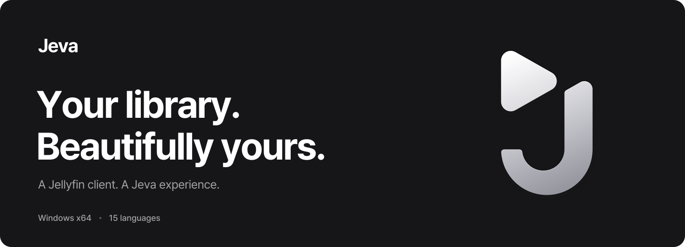
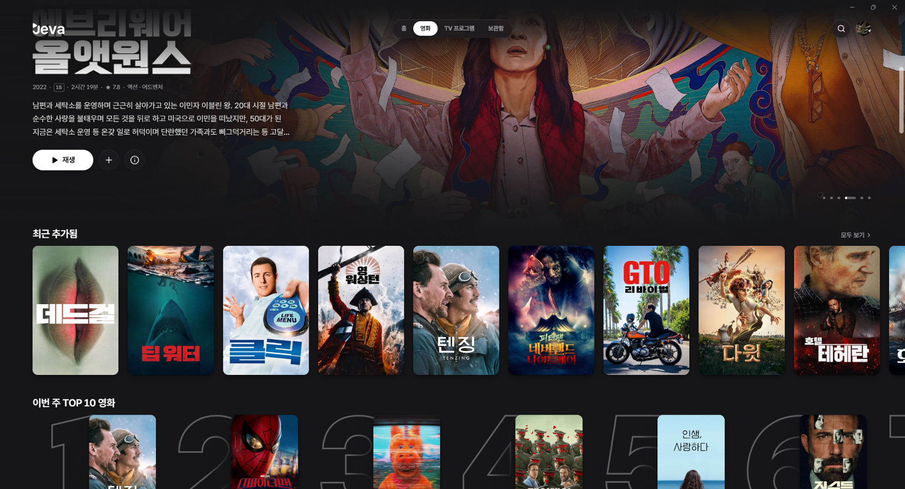
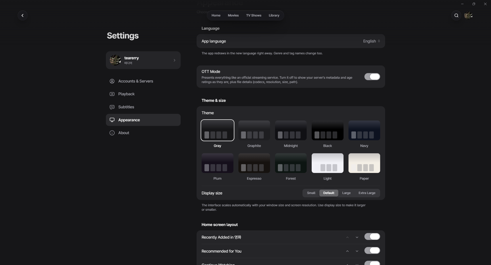

<a href="../../README.md">English</a> · <a href="README.ko.md">한국어</a> · <a href="README.ja.md">日本語</a> · <a href="README.zh-CN.md">简体中文</a> · <strong>繁體中文</strong>

<a href="https://github.com/tearerry/Jeva/releases"><strong>下載 Windows 版本 ↗</strong></a> · <a href="https://github.com/tearerry/Jeva/issues">回報問題 ↗</a>

# 讓你的媒體資料庫，以更美的方式呈現。

**Jeva** 是一款獨立開發的 Jellyfin Windows 用戶端，讓你能以串流平台般的精緻介面，瀏覽和欣賞自己伺服器上的電影與影集。

## 主要功能

- **個人化首頁：** 選擇首頁顯示的媒體庫，自訂內容區塊的顯示方式與順序。
- **串流平台風格介面：** 透過精美的劇照、海報與詳細資訊探索電影和影集。
- **豐富的外觀設定：** 自由切換主題、精選內容版面與卡片樣式。
- **便利的內容瀏覽：** 支援依媒體庫瀏覽、搜尋、篩選和排序。
- **更多影片類型：** 支援音樂錄影帶與本機附加影片（Local Extras）。
- **支援 15 種語言：** 並可依不同地區顯示適用的年齡分級。

 

## 開始使用

1. 前往 [Releases](https://github.com/tearerry/Jeva/releases) 下載最新的 Windows 安裝程式。
2. 安裝並啟動 Jeva。
3. 連線至你的 Jellyfin 伺服器。

**支援平台：** Windows x64

## 開發者模式

Jeva 內建隱藏的開發者模式，可用於重新整理中繼資料及編輯媒體資訊。

開啟 **設定 → 關於（About）**，**連續點擊 Jeva 圖示數次**即可啟用。

## 意見回饋

若發現問題或有改善建議，歡迎前往 [GitHub Issues](https://github.com/tearerry/Jeva/issues)。

**聲明：** Jeva 為獨立專案，與 Jellyfin 專案並無合作、從屬或官方認可關係。
