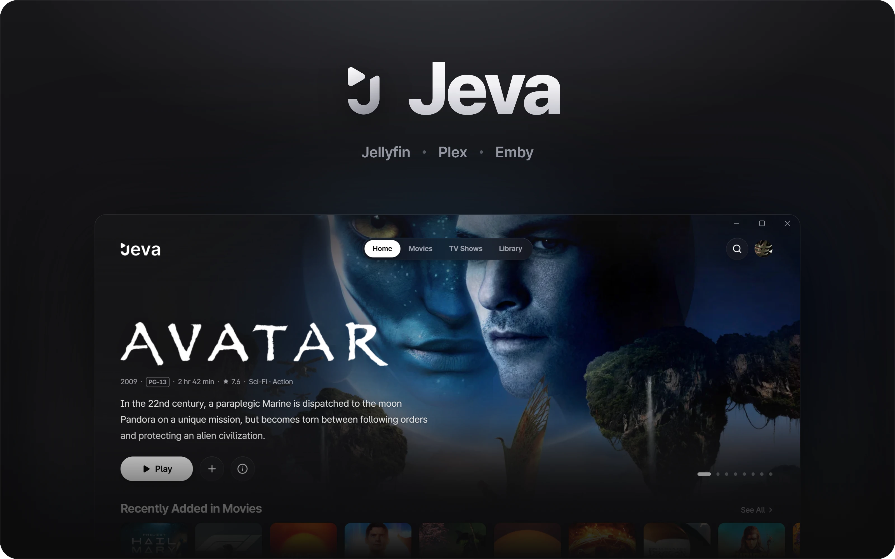
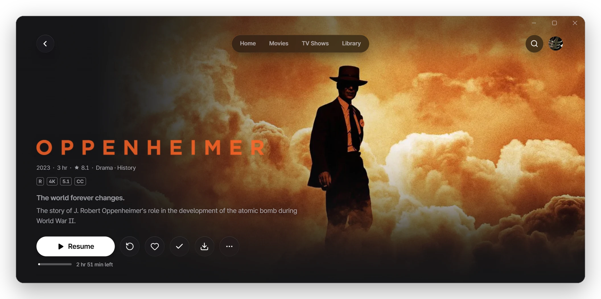
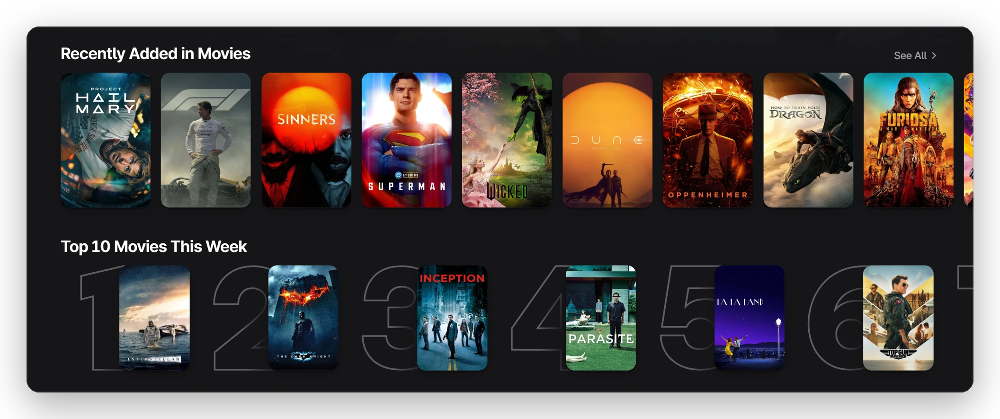
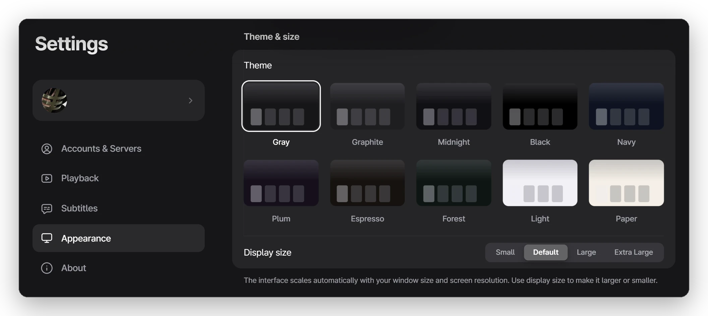

  

<h3 align="center">透過優雅介面，探索媒體庫中的電影與影集。</h3>

Jeva 是一款為 Jellyfin、Plex 和 Emby 打造的精緻 Windows 應用程式：流暢、充滿影院質感，就像你專屬的串流服務。

  <a href="https://github.com/tearerry/Jeva/releases/latest"><picture><source media="(prefers-color-scheme: dark)" srcset="../../assets/buttons/download-zh-TW-dark.326a36f2f0db.png"></picture></a>&nbsp;&nbsp;
  <a href="https://github.com/tearerry/Jeva/releases"><picture><source media="(prefers-color-scheme: dark)" srcset="../../assets/buttons/notes-zh-TW-dark.5ac07da1cd84.png"></picture></a>

Windows 10 和 11 · x64 · 安裝程式或可攜式 ZIP

<a href="../../README.md">English</a> · <a href="README.ko.md">한국어</a> · <a href="README.ja.md">日本語</a> · <a href="README.zh-CN.md">简体中文</a> · <b>繁體中文</b> · <a href="README.es.md">Español</a> · <a href="README.fr.md">Français</a> · <a href="README.de.md">Deutsch</a> · <a href="README.pt-BR.md">Português (BR)</a> · <a href="README.it.md">Italiano</a> · <a href="README.nl.md">Nederlands</a> · <a href="README.ru.md">Русский</a> · <a href="README.tr.md">Türkçe</a> · <a href="README.id.md">Bahasa Indonesia</a> · <a href="README.ar.md">العربية</a>

 

<h3 align="center">每部作品，都以最好的樣貌呈現</h3>

片名標誌、海報、演職員與真正需要的資訊，一個畫面就能看完。按下播放，從上次停下的地方繼續。

 

<h3 align="center">值得細細瀏覽的推薦</h3>

最近新增、本週 TOP 10 與主題推薦，全都來自你自己的媒體庫。

 

<h3 align="center">隨你喜好</h3>

10 種主題、4 種顯示大小、自訂首頁版面，每個分頁還能有自己的風格。

 

## 細節之處

- **從第一個畫面開始的字幕** 直接從檔案讀取，跳到哪裡都能立即顯示。
- **你的語言，你的分級** 支援 15 種語言，年齡分級依你所在國家的方式顯示。
- **首頁由你決定** 選擇哪些媒體庫出現在首頁，也能為每個媒體庫設定獨立分頁。
- **防雷保護** 依媒體庫模糊尚未觀看集數的簡介。
- **花絮與照片** 作品頁面提供預告片與幕後花絮，相簿可全螢幕瀏覽。
- **從上次的地方繼續** 繼續觀看與下一集，隨時與伺服器同步。

## 開始使用

需要 Windows 10 或 11（x64），以及一台 Jellyfin、Plex 或 Emby 伺服器。

1. 從<a href="https://github.com/tearerry/Jeva/releases/latest">最新版本</a>下載 Jeva。
2. 開啟應用程式並選擇伺服器，同一網路中的伺服器會自動出現。
3. 登入後即可開始觀看。

不想安裝？下載可攜式 ZIP，可在任何資料夾中執行，資料就存放在它旁邊。

## 開發者模式

可以直接在應用程式中編輯中繼資料與圖片，或掃描媒體庫。在<strong>設定 → 關於</strong>中連續點按 Jeva 圖示七次即可開啟。

 

<a href="https://github.com/tearerry/Jeva/issues">回報問題或提出建議</a>

Jeva 是獨立專案，與 Jellyfin、Plex 和 Emby 無關聯，也未獲得其認可。

